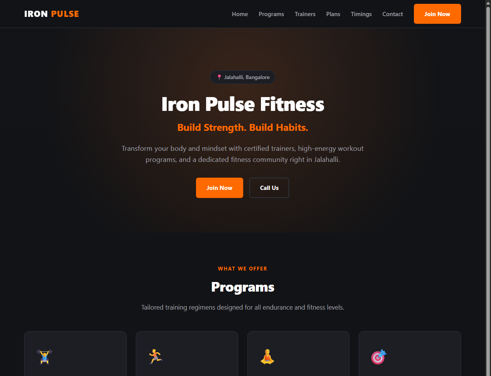
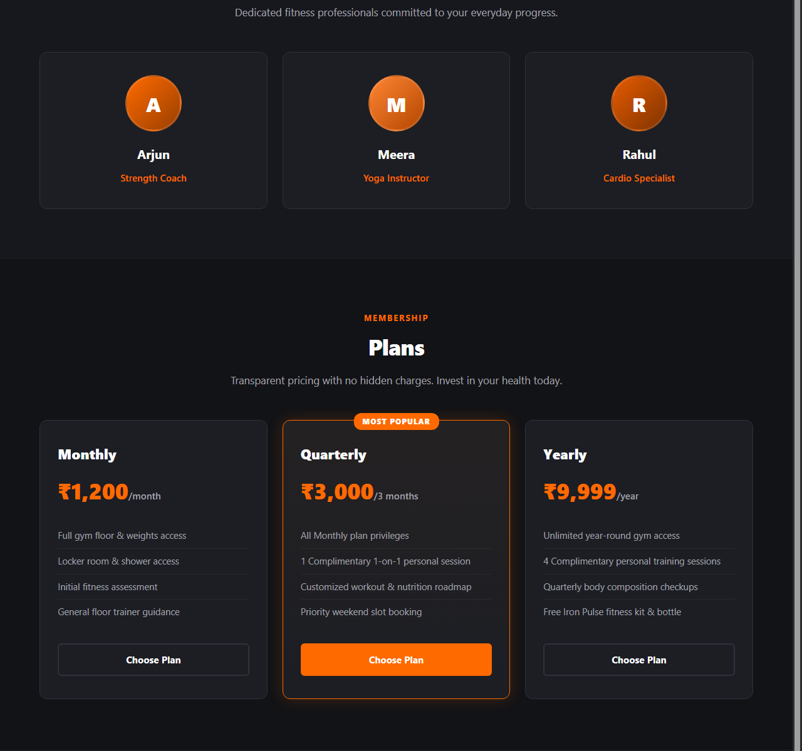
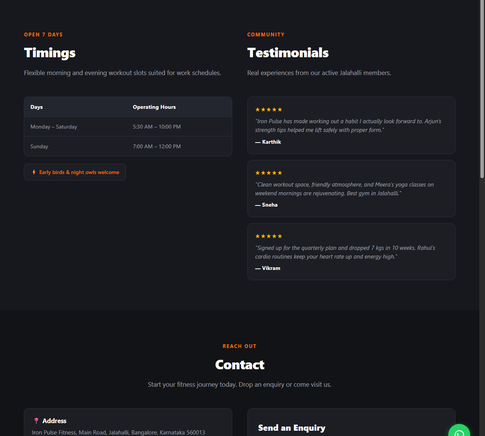

# Iron Pulse Fitness — Official Website

A modern, high-performance gym website designed and built for **Iron Pulse Fitness**, located in Jalahalli, Bangalore. Built using pure, semantic HTML, CSS, and modern vanilla JavaScript with zero dependencies, frameworks, or build configurations.

---

## Demo Photos

### 1. Hero & Programs Overview


### 2. Expert Trainers & Membership Plans


### 3. Timings, Member Reviews, & WhatsApp Enquiry Form


---

## About the Business

- **Gym Name:** Iron Pulse Fitness
- **Location:** Main Road, Jalahalli, Bangalore, Karnataka 560013
- **Tagline:** *"Build Strength. Build Habits."*
- **Operating Hours:**
  - **Monday – Saturday:** 5:30 AM to 10:00 PM
  - **Sunday:** 7:00 AM to 12:00 PM
- **Contact & WhatsApp:** +91 98765 43210
- **Programs Offered:**
  - **Strength Training:** Progressive resistance training to build lean muscle and functional strength.
  - **Cardio:** High-intensity endurance conditioning for stamina and cardiovascular health.
  - **Yoga:** Mindful flow and recovery to enhance flexibility and core stability.
  - **Personal Training:** 1-on-1 personalized fitness coaching, form correction, and nutrition planning.
- **Featured Coaches:**
  - **Arjun:** Strength Coach
  - **Meera:** Yoga Instructor
  - **Rahul:** Cardio Specialist
- **Membership Packages:**
  - **Monthly:** ₹1,200 / month
  - **Quarterly:** ₹3,000 / 3 months (*Most Popular*)
  - **Yearly:** ₹9,999 / year

---

## Features

- **Direct WhatsApp Lead Conversion:**
  - Form validation for Name and Phone number before submission.
  - Automatically composes a clean, prefilled WhatsApp message with the visitor's details, selected membership plan, and enquiry note.
  - Direct WhatsApp link opening via `https://wa.me/919876543210`.
- **Always-Accessible Floating WhatsApp CTA:**
  - Fixed button in the bottom-right corner across all viewports for immediate 1-click enquiries.
- **Mobile Responsive Navigation:**
  - Sticky navbar with smooth hamburger drawer toggle on mobile screens.
  - Automatically closes when any navigation link is tapped.
- **Smart Plan Selection UX:**
  - Clicking "Choose Plan" on any pricing card automatically pre-selects that membership option in the enquiry form dropdown and smoothly scrolls down.
- **Interactive Location Map:**
  - Embedded Google Map iframe pinpointing Jalahalli, Bangalore without requiring paid API keys.
- **Dark Aesthetic with Orange Accents:**
  - Professional dark charcoal palette (`#121316`) paired with energetic gym orange (`#ff6a00`).
  - Handcrafted CSS gradient backgrounds and CSS initials avatars with zero external image dependencies.
- **SEO & Accessibility Ready:**
  - Semantic HTML5 structure (`<header>`, `<nav>`, `<main>`, `<section>`, `<footer>`).
  - Clean meta tags, viewport settings, and accessible ARIA attributes.
- **Zero External Overhead:**
  - Uses native system fonts and local assets. Loads instantly on slow 3G/4G mobile connections.

---

## Tech Stack

- **HTML5:** Semantic, accessible markup.
- **CSS3:** Flexbox, CSS Grid, custom properties, and responsive media queries down to 375px.
- **JavaScript (ES6+):** Vanilla script for navigation toggling, form validation, and dynamic WhatsApp message composition.
- **No external dependencies, build tools, libraries, or frameworks.**

---

## How to Run the Website

You do **not** need Node.js, a web server, or any command-line tools to view or run this website:

1. Navigate to the project directory:
   ```text
   FUTURE_FS_03
   ```
2. **Double-click `index.html`** in Windows Explorer (or open it with any web browser such as Chrome, Edge, Firefox, or Safari).
3. The website will immediately load all styles, scripts, layout sections, and map.

---

## How to Customize Details

### 1. Changing the WhatsApp Number
The WhatsApp phone number is declared in **one single constant** at the very top of `script.js`:
```javascript
const WHATSAPP_NUMBER = "919876543210";
```
Simply replace `"919876543210"` with your gym's international format phone number (country code without `+` or spaces, e.g. `"9198XXXXXXXX"`).

Also update the phone number in `index.html` for direct telephone calling and visible text:
- In the hero section: `<a href="tel:+919876543210" class="btn btn-outline">Call Us</a>`
- In the contact section: `<a href="tel:+919876543210">+91 98765 43210</a>`
- In the floating WhatsApp button href: `https://wa.me/919876543210?text=...`

### 2. Updating Gym Name, Tagline, or Address
Open `index.html` in any text editor:
- **Gym Name:** Search for `Iron Pulse Fitness` and `IRON <span>PULSE</span>` to rename.
- **Tagline:** Search for `Build Strength. Build Habits.` to change the brand tagline.
- **Address & Operating Hours:** Located within the `#contact` section and `#timings-reviews` table.

### 3. Adjusting Membership Plans or Prices
Open `index.html` and locate the `#plans` section:
- Modify plan titles (`Monthly`, `Quarterly`, `Yearly`), pricing (`₹1,200`, `₹3,000`, `₹9,999`), and benefit bullet points as needed.
- If plans change, also update the `<option>` values inside `<select id="plan" name="plan">` in the contact form.

### 4. Updating Trainer Profiles
Under the `#trainers` section in `index.html`, modify the names, roles, and avatar initials (e.g. `<span>A</span>` for Arjun, `<span>M</span>` for Meera, `<span>R</span>` for Rahul).

---

## File Structure

```text
FUTURE_FS_03/
├── index.html       # Semantic single-page website structure
├── style.css        # Clean dark charcoal & orange styling (no comments)
├── script.js        # Form validation & WhatsApp integration (no comments)
├── PITCH.md         # Non-technical client proposal for gym owners
├── README.md        # Documentation and walkthrough guide
├── .gitignore       # Git ignore rules for clean repo tracking
└── assets/          # Demo screenshots embedded in documentation
    ├── demo-hero.png
    ├── demo-plans.png
    └── demo-contact.png
```
